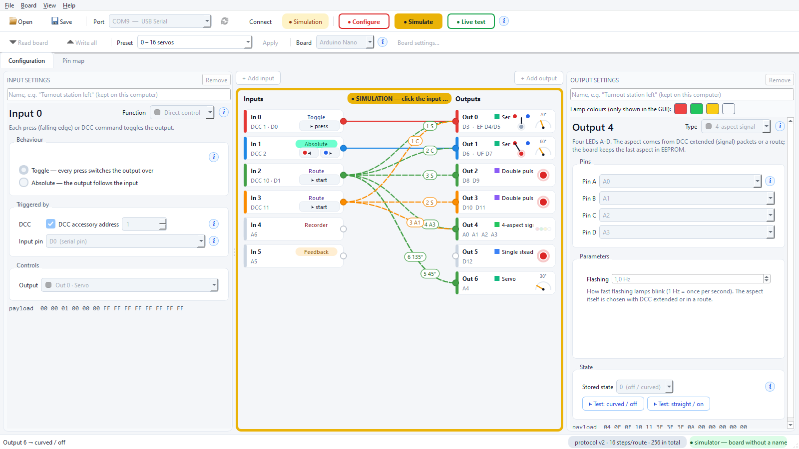
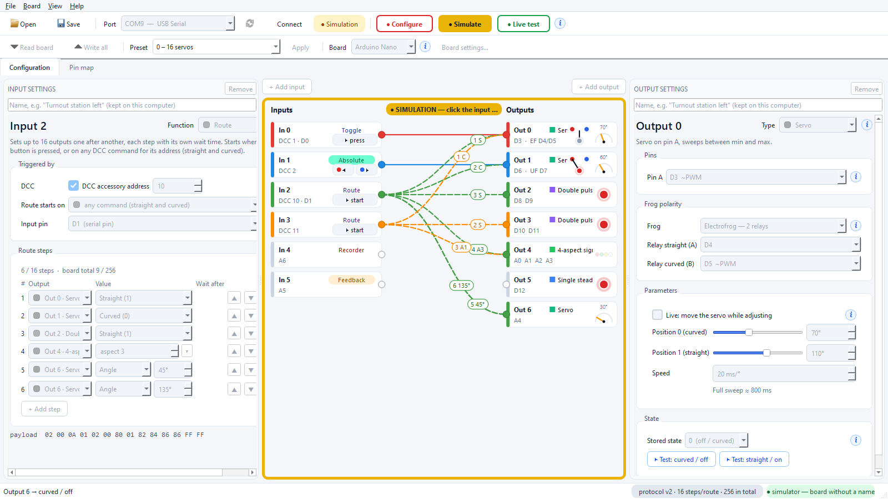
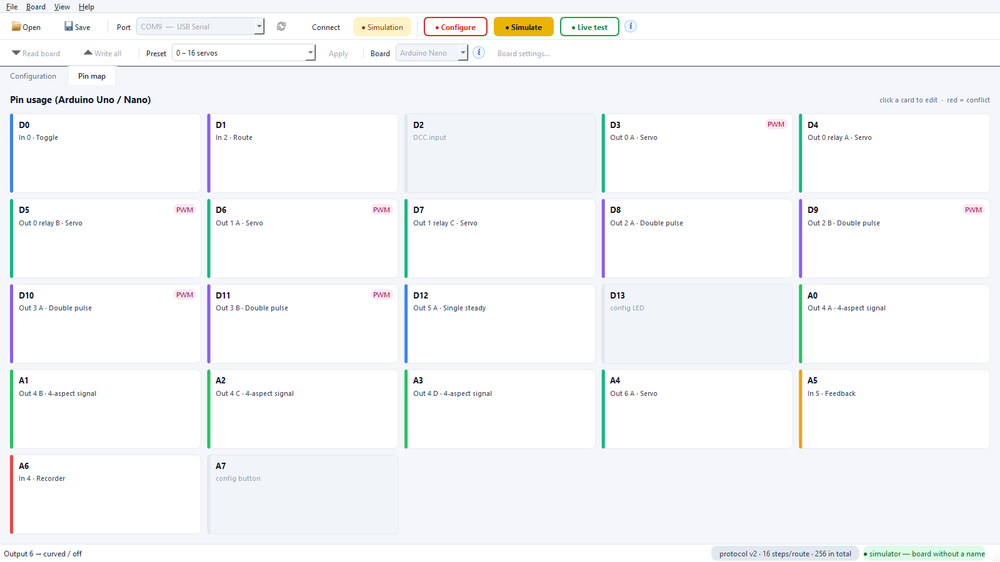
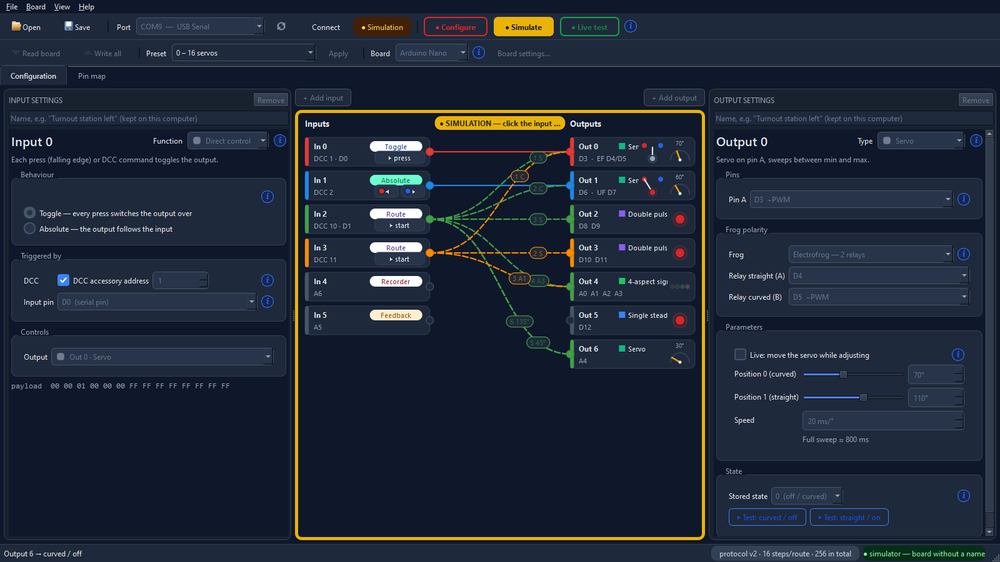

# GPIOcore

**A DCC accessory decoder on an Arduino Nano, with a configuration program for Windows.**

GPIOcore turns an Arduino Nano (or Uno) into a decoder for your model railway with **16 inputs and
16 outputs**. Every output can be a servo, a turnout coil, a light, a signal or a light effect.
Inputs are push buttons, toggle switches or track contacts, and they can start **routes**. You set
everything up with the **GPIOcore Configurator** over USB, without writing code.

Part of [Open-Source-Model-Railway-Electronics](https://github.com/Open-Source-Model-Railway-Electronics).

---

## What it can do

| | |
|---|---|
| **Outputs** | Servo (with speed, and unifrog / electrofrog relays), single / double steady, single / double pulse (turnout coils), single / double flashing, swing light (level crossing), fireplace, TL tube, welder, PWM, 4-aspect signal |
| **Inputs** | Toggle, absolute (follows a switch), route, recorder, feedback (occupancy to the command station) |
| **Routes** | Up to 16 steps per route, each with its own wait time. A route starts on a button or a DCC command: any command, only "straight" or only "curved" |
| **DCC** | Accessory addresses for inputs and routes. DCC extended packets set a servo angle directly (0–180°) or a signal aspect |
| **Configure without a board** | Work offline, try it in the built-in simulation, then write it to the board |
| **Phone remote** | Adjust servo positions from your phone while you look at the turnout |
| **Config button** | Set servo end positions on the layout with a button and your DCC throttle |

---

## What you need

- An **Arduino Nano** (ATmega328P; also the clones with a CH340 USB chip) or an Arduino Uno.
- A DCC signal on **D2** (through an optocoupler circuit), if you use DCC.
- Optional: a push button on **A7** (with a 10 kΩ pull-up to 5 V) for the config button.
  **D13** is the config LED (the Nano's own LED).
- A Windows PC with a USB cable.

**Reserved pins:** D2 = DCC, D13 = config LED, A7 = config button. All other pins (D0–D12 except D2,
A0–A6) are free for inputs and outputs. D0/D1 are the USB serial pins: they are only used as inputs
when no PC is connected. A6 is an input only (Nano).

---

## Getting started

1. **Download** the release (`GPIOcore` zip) and unpack it anywhere. It contains
   `GPIOcoreGUI.exe`, the firmware `GPIOcore.hex` and the upload tool. Nothing needs to be installed.
2. **Start** `GPIOcoreGUI.exe`.
3. **Put the firmware on the Nano:** plug in the Nano, choose *Board → Flash firmware…*, pick the
   port and click **Flash**. The program uses the `GPIOcore.hex` that came with it.
4. **Connect:** choose the port in the toolbar and click **Connect**.
5. **Read the board** with **Read board**, or start from a **preset** (second toolbar row) or a
   board file (*File → Open*, see `examples/`).

### The three modes

The toolbar always shows one of three modes. The colour of the frame around the drawing tells you
where you are:

| Mode | Frame | What you can do |
|---|---|---|
| **Configure** | red when connected | Change everything. When connected, every change goes to the board straight away (after a short pause) |
| **Simulate** | yellow | Your configuration on a simulated board. Click inputs and watch the outputs. Nothing can be changed |
| **Live test** | green | Click inputs and watch the **real** board. Connects by itself. Nothing can be changed |

You can also work **without a board** (offline): *File → New board (offline)…*, start empty or from a
preset, and save it as a file. Later you connect and click **Write all**.

### Saving your work

- **Save** (Ctrl+S) always asks where to save. **Open** is Ctrl+O.
- Names of inputs and outputs are kept on this computer, in the board file
  (`Documents/GPIOcore/boards/`). The board itself keeps the configuration in its EEPROM.
- When you close the program with unsaved changes, it asks what to do.

---

## Outputs

Click an output on the right side of the drawing to edit it. Choose the **Type**, the **pins** and the
**parameters**. Pins that are already in use are shown in **red** in the lists. Choosing a pin that
is in use takes it over: the other input or output becomes "not in use".

Use **+ Add output** to add one, and the trash can (hover over a block) or **Remove** to take it away.

### Servo

- **Position 0 (curved)** and **Position 1 (straight)**: the two end positions, 10–170°.
- **Speed**: milliseconds per degree.
- **Live** (when connected): the servo follows the slider while you adjust it.
- **Frog**: none, *unifrog* (one relay) or *electrofrog* (two relays, switched halfway).
- At power-up the servos start one by one, 500 ms apart, each in its last position.
- A DCC extended packet or a route step with a value of 0–180 sends the servo straight to that angle
  (at its own speed). Values above 180 are ignored.

### 4-aspect signal

Four LEDs on pins A–D; lamp 1 = bit 0 = pin A. The aspect comes from a **DCC extended** packet or from
a route step (use the aspect picker next to the value). Set the **blink frequency** once per signal (in
Hz); flashing lamps then follow that rhythm.

---

## Inputs and routes

Click an input on the left side to edit it. The **Function** decides what it does:

- **Toggle**: every press (or DCC command) switches the output over.
- **Absolute**: the output follows the switch, or the DCC direction.
- **Route**: sets up to 16 outputs one after another. Per step you choose the output, the value
  (straight / curved, an angle, or a signal aspect) and the wait time after it.
  **Route starts on** chooses: any DCC command, only *straight*, or only *curved*. Example: a level
  crossing that closes on "straight" and opens with a second route on "curved".
- **Recorder**: long press = record on/off, short press = play on/off.
- **Feedback**: reports an occupied track to the command station.

You can also make a route by **dragging**: drag from an output to the route input to add a step.

A DCC command for the same address is ignored for 500 ms after the first one, so a command station
that repeats commands does not toggle twice.

---

## Pin map

The **Pin map** tab shows every pin of the board and what uses it. A red card is a conflict. Click a
card to edit that input or output.

---

## Phone remote

*Board → Phone remote…* shows a QR code. Scan it with a phone on the **same Wi-Fi network**. You get
a page with all servos:

- two sliders per servo, **curved** and **straight**: the servo moves along while you slide, and the
  position is stored at once. The slider in the program moves along too;
- −1° / +1° buttons for fine tuning;
- buttons to throw the turnout.

The page only works with the code in the QR address, and only while the window is open.

---

## Config button (on the layout, without a PC)

With a push button on A7:

1. **Hold the button 2 seconds:** config mode, the LED on D13 blinks.
2. **Short press:** the next servo is selected and moves over, so you can see which one it is.
3. Select **loco address 9999** on your DCC throttle:
   - the **speed knob** moves the servo;
   - **F1** stores the curved position, **F2** the straight position;
   - **F3** throws the servo, **F4** selects the next servo.
4. **Hold the button 2 seconds** again to leave config mode.

---

## Dark mode and languages

The program follows the Windows light/dark setting. It speaks English, Dutch, German, French, Spanish,
Italian, Polish, Czech, Danish, Norwegian, Swedish, Hungarian and Portuguese (*View → Language*).
Every setting has an **i** button with an explanation.

---

## For developers

| Folder | Contents |
|---|---|
| `software/GPIOcore/` | Arduino firmware (`GPIOcore.ino`) |
| `software/gui/` | Qt 6 configuration tool (`CMakeLists.txt`, open in Qt Creator) |
| `release/` | Built firmware (`GPIOcore.hex`) and, after `release.py`, the GUI for end users |
| `docs/images/` | Screenshots for this manual |

From the repository root:

| Command | What it does |
|---|---|
| `python build.py` | Empties `release/` and builds everything into it: firmware (`GPIOcore.hex`) and the GUI with Qt files, avrdude and examples |
| `python release.py` | Asks the version and notes, writes the version into the firmware and the GUI, builds, then commits, tags, pushes and makes a GitHub release with `release/` as a zip (`--dry-run` to try, `--no-build` to publish `release/` as it is) |
| `python software/GPIOcore/src/build.py` | Firmware only, straight to `release/GPIOcore.hex` |
| `python software/GPIOcore/src/upload.py [COM9] [--build]` | Puts `release/GPIOcore.hex` on a Nano with `software/gui/tools/avrdude` (port: the only USB serial port, or a choice) |
| `python software/gui/build.py` | GUI only (Release build, Qt from `C:/Qt`) into `release/` |

`release/` is build output and not in git; `release.py` publishes it as a GitHub release.
`build.py` and `release.py` only assume the `software/*/src/build.py`, `software/*/build.py` layout, so they
can be copied to other repositories.

Screenshots: `GPIOcoreGUI.exe --lang en --size 1600x900 --open examples/routes-demo.json --demo --tab outputs --select 0 --screenshot out.png`
(`--tab inputs|outputs|pins`, `--theme light|dark`).

Documentation: [PROTOCOL.md](PROTOCOL.md) (serial protocol), [EEPROM.md](EEPROM.md) (memory use),
[REVIEW_GPIOcore.md](REVIEW_GPIOcore.md) (review and change log).

## License

CC0 1.0: you can copy, modify and use it, also commercially, without asking permission.
