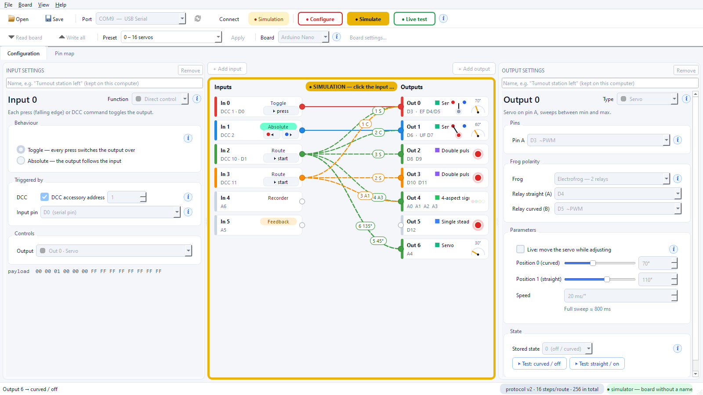

# GPIOcore

**Turn a cheap Arduino Nano into a decoder for your model railway. No programming needed.**

GPIOcore drives up to **16 things** on your layout (servos, turnouts, lights, signals, sounds) and listens to
up to **16 things** (push buttons, switches, track sensors, your DCC command station). You set it all up with a
program on your Windows PC, try it in the built-in simulator, and write it to the board.

Part of [Open-Source-Model-Railway-Electronics](https://github.com/Open-Source-Model-Railway-Electronics).

## What can it do?

- **Turnouts:** servos with adjustable speed, coil turnouts, stall motors, and frog relays so locos never stall.
- **Lights:** on/off, blinking, level crossing lights, fireplace, TL tube, welder, photographer's flash, and
  slow fading for day and night.
- **Signals:** up to four lamps, any aspect, set by DCC or a route. Automatic **block signals** that set themselves
  from track occupancy.
- **Routes:** one button or one DCC command does up to 16 things one after another. A station entry, a level
  crossing, a crane.
- **Sound:** plays MP3 files (bell, announcement, whistle) with a DFPlayer Mini.
- **Sensors:** light sensors, reed switches, or many buttons on one analog pin.
- **Boards together:** one board with the buttons, more boards with the turnouts, linked with one wire.
- **With or without DCC:** works with a DCC command station, or with only buttons and sensors.

## Get started

1. **Download** `GPIOcore-…-setup.exe` from [Releases](https://github.com/Open-Source-Model-Railway-Electronics/GPIOcore/releases)
   and install it.
2. **Plug in** an Arduino Nano with a USB cable.
3. **Board → Flash firmware…** puts GPIOcore on the Nano.
4. **File → Open example…** and pick one, for example a servo decoder or a level crossing.
5. Click **Simulate** and press the buttons on the inputs. Happy? **Connect** and **Write all**.

No board yet? Everything works offline and in the simulator.

## Documentation

| | |
|---|---|
| **[Manual](docs/Manual.md)** | The program, all outputs and inputs, routes, board link, block signals |
| **[Examples](examples.md)** | Step-by-step recipes: servo decoder, coil decoder, level crossing with a bell, lights at dusk, ... |
| **[Hardware](hardware/)** | The GPIOcore boards: schematics, PCB files, bill of materials *(coming)* |
| **[Protocol](PROTOCOL.md)** · **[EEPROM](EEPROM.md)** | For developers: the serial protocol and the memory map |

## What you need

| Part | Why |
|---|---|
| **Arduino Nano** (a cheap clone with a CH340 USB chip is fine), or a GPIOcore board | the decoder itself |
| A **Windows PC** and a USB cable | to set it up; not needed while the layout runs |
| A **5 V power supply** for servos | a Nano can't power more than one or two servos |
| Optional: a DCC input (optocoupler) on **D2** | only with a DCC command station |
| Optional: relay modules, a coil driver (ULN2803), a DFPlayer Mini, ... | depending on what you build |

## Status

**v0.1, pre-release.** The software is complete and tested in the simulator; the boards are not tested yet.
Version 1.0 follows when the hardware is done.

## For developers

| Folder | Contents |
|---|---|
| `software/GPIOcore/` | Arduino firmware |
| `software/gui/` | Qt 6 configuration program, simulator and tests (`CMakeLists.txt`) |
| `hardware/` | KiCad projects |
| `docs/` | manual and images |

| Command (from the repository root) | What it does |
|---|---|
| `python build.py` | builds the firmware, the program and the installer into `release/` |
| `python release.py` | sets the version, builds, tags and publishes a GitHub release (`--dry-run` to try) |
| `python software/GPIOcore/src/build.py` | firmware only, to `release/GPIOcore.hex` |
| `python software/GPIOcore/src/upload.py [COM9]` | puts `release/GPIOcore.hex` on a Nano |

## License

CC0 1.0: you may copy, change and use it, also commercially, without asking.
