# IOcore Manual

IOcore consists of two pieces of software: the **firmware** that runs on the decoder, and the **GUI** (the
configurator) that runs on your PC.

With it an Arduino Nano, a DCCnext or an IOcore board can do almost anything on your model railway: from one
lamp to servos and complete routes. There are light effects, signals that need no settings, sound, and an
automatic block system that can be functional or just for show.

Everything comes down to two things: **inputs** and **outputs**.

- An **input** is something that you or a train does: a DCC command, a push on a button, a train on a sensor.
- An **output** is something that moves, lights up or makes a sound: signals, lamps, decouplers, turnout
  motors, LED strips... you name it.

# About this manual

First the basic controls of the program. Then the outputs: what the board can actually do. Then the inputs: how
you control the outputs. Last the advanced features, such as linking boards and the automatic block signals.

# Getting started: the GUI basic controls

| Part | What it does |
|---|---|
| **Open / Save** | Open or save a board file. Your files are in `Documents\IOcore\boards`. |
| **Port / Connect** | Choose the COM port of your board and click **Connect**. Next to it you see the state: *Offline*, *Connected* or *Simulation*. ⟳ looks for ports again. |
| **Read board / Write all** | **Read board** loads what is on the board (it replaces what is on screen). **Write all** puts everything on screen on the board. |
| **Preset** | A ready-made configuration. Choose one and click **Apply**. |
| **Board / Board settings…** | Which board you have (Nano, DCCnext, ...) and the settings for the whole board. |
| **GUI mode** | Configure, Simulate or Live test, see below. |

## The three modes

| Mode | What you do |
|---|---|
| **● Configure** | Change things. Offline you prepare a board; connected, every change goes to the board at once. |
| **● Simulate** | Your configuration on a pretend board. No board needed. Click the buttons on the inputs and watch the outputs. You cannot change anything here. |
| **● Live test** | The same, but with the real board. It connects by itself. Use this to check your wiring. |

**Tip:** first try it in Simulate. Works? Then write it to the board and check it in Live test.

The **(i)** buttons everywhere in the program explain the thing next to them.

## Main menu items

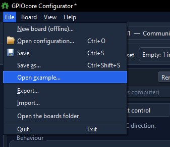

- **New board (offline)**: start with an empty board, without a board connected.
- **Open configuration / Save / Save as**: your board files.
- **Open example**: ready-made examples, such as a level crossing. Open one and look how it is made.
- **Export / Import**: save some inputs, outputs or the board settings in a file of their own, or add them from
  another file. Handy to copy a turnout setup to another board.
- **Open the boards folder**: opens `Documents\IOcore\boards`.

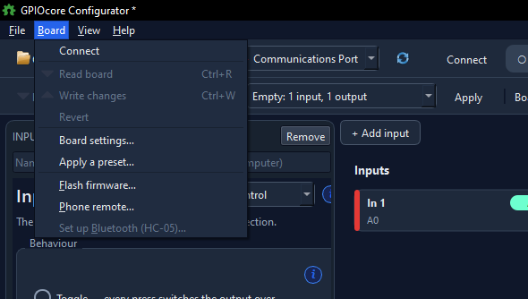

- **Connect**, **Read board**, **Write changes**: the same as the buttons. *Write changes* only writes what you
  changed.
- **Revert**: throws away the changes that are not on the board yet.
- **Board settings / Apply a preset**: the same as the buttons.
- **Flash firmware**: puts the newest firmware on the board.
- **Phone remote**: adjust servos with your phone, while you stand at the layout. See below.
- **Set up Bluetooth (HC-05)**: a wireless connection instead of the USB cable.

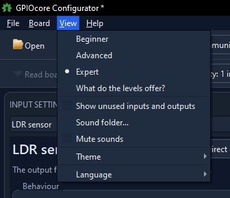

- **Beginner / Advanced / Expert**: how much the program shows you. Can't find something? Choose a higher level.
  - *Beginner*: servos, lights, turnout coils, buttons, DCC addresses and simple routes.
  - *Advanced*: also light effects, signals, PWM, sound, frog relays, analog inputs and custom values.
  - *Expert*: also automatic block signals, sensor inputs and semaphore arms.
- **Show unused inputs and outputs**: also show the empty ones.
- **Sound folder / Mute sounds**: in Simulate and Live test the PC plays the tracks of a sound effect output. Put
  them in `Documents\IOcore\sounds` with the same names as on the SD card (`0001.mp3`, `0002.mp3`, ...).
- **Theme**: light or dark. **Language**: works after a restart.

## Saving your work

- **The board remembers everything itself**, also without power.
- **Save** (Ctrl+S) stores your setup in a **board file** on your PC, in `Documents\IOcore\boards`. The file
  also has the **names** of your inputs and outputs: those are not stored on the board.
- The program finds the right file by the **name of the board** (see *Board settings*). So give every board its
  own name.
- **Read board** loads what is on the board; **Write all** puts what is on screen on the board, for example
  after working offline.
- **Export** saves only some inputs, outputs or the board settings in a file of their own. **Import** adds them
  to the board on screen, on the same numbers or on free places. Lines between the imported parts are
  renumbered for you. Handy to reuse your resistor ladder or a turnout setup on the next board.
- Closing the program with unsaved changes? It asks what to do.

## Other controls

### Board settings

- **Name**: up to 16 letters, stored on the board. The program finds the file of a board by this name, so give
  every board its own name.
- **Board type**: Arduino Nano, DCCnext or Jack of all trades. It decides which pins you can choose.
- **Own wait time per route step**: off = every route step waits the same time (*Wait time per step*). On = every
  step has its own wait time, but the board has room for fewer steps.
- **Route interlocking**: what happens when a route starts while another one is still running.
  *Off* = both run. *On* = the second one is ignored. *Automatic* = routes with turnouts run one at a time,
  routes with only lights may run together.
- **Block signals flash at**: how fast flashing block signals blink. 1 Hz = once a second.
- **D0 / D1 as inputs and outputs (no board link)**: see *Advanced features*.

### Phone remote

Adjust your servos with your phone, standing next to the layout. The phone must be on the same Wi-Fi as the PC.
Scan the code with the camera of your phone and keep the program open. The first time Windows may ask whether the
program may use the network: allow it for private networks.

# Outputs

The most important chapter, the outputs! The things your decoder can do.

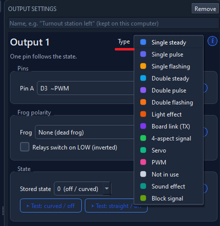

## Basic outputs

These outputs are available:

- **Single steady**: one pin, on or off. For a lamp, a relay, etc.
- **Single pulse**: one short pulse on one pin. Useful for decouplers.
- **Single flashing**: one pin that turns on and off all the time. For a single blinking light.
- **Double steady**: two pins; one is high while the other is low. For turnout motors such as the MTB MP1, or a
  red / green signal (but see the signals below).
- **Double pulse**: for turnouts with coils (magnetic point motors).
- **Double flashing**: two pins that blink in turn.

**Note 1.** Every flashing and pulse output has its own time.

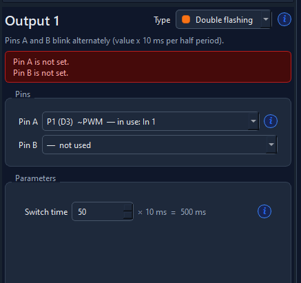

**Note 2.** Steady and pulse outputs (not flashing) and the servo can also switch relays for the frog of a turnout.

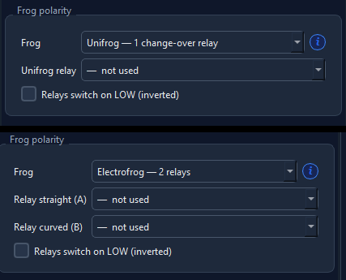

- **Unifrog**: one relay connects the frog to the right rail. With a servo it switches exactly halfway the move.
- **Electrofrog**: two relays. When the turnout moves, the frog is first made dead, then the turnout moves, and
  then the other relay gives the frog its new polarity.

## Light effects

There are several light effects for your layout:

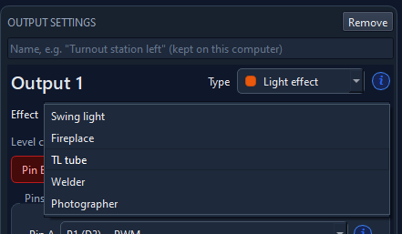

| Effect | What it is | Pins |
|---|---|---|
| Swing light | level crossing lights, two lamps blinking in turn | 2 |
| Fireplace | a flickering fire or campfire | 2, PWM (~) |
| TL tube | a fluorescent tube that flickers a few times before it stays on | 1, PWM (~) |
| Welder | random blue welding flashes | 1 |
| Photographer | a camera flash now and then | 1 |

The fireplace and the TL tube need PWM pins (marked with **~**).

## Board link

Connects more than one board to each other, so they work together. See *Advanced features*.

## 4-aspect signal

A signal with up to four lamps that needs no settings on the board. Which aspect it shows is set by your train
program or by a route (*).

At the top you choose the colours of the lamps. They are only used in the GUI, so you can see what you are doing.

Choose up to 4 pins. A lamp can also flash; you set the speed in blinks per second (Hz).

The **Aspect numbers** button opens a small window. Choose for each lamp: on, off, flashing or flashing in counter
phase. The window shows the DCC extended number for that aspect. Put that number in your train program or in a
route (*).

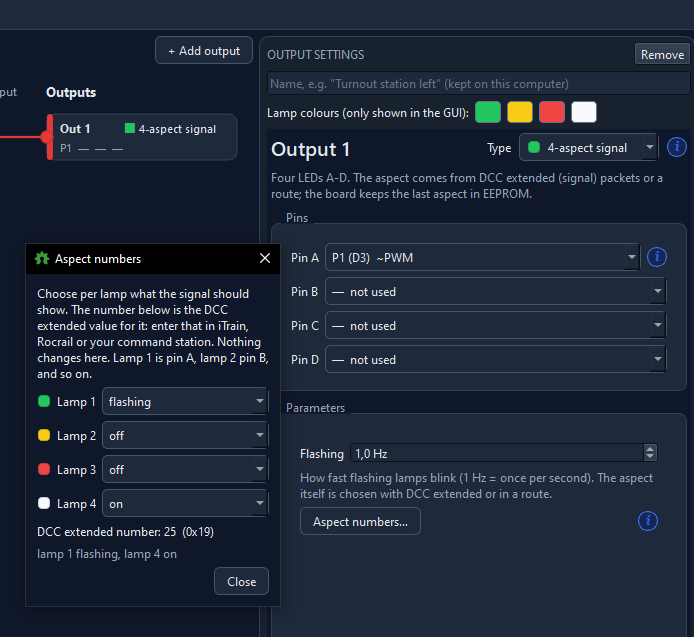

(*) The 4-aspect signal only works with DCC extended commands or a route.

## Servo

The servo output drives one servo motor. Servos are good for turnouts, semaphores, gates, doors and really anything
that has to move... except the trains themselves.

A servo moves between two positions that you set with the sliders. Tick **Live** and the servo moves along while
you slide.

The speed is set in ms per degree; the total time of a move is shown next to it.

A servo also listens to DCC extended commands: then it goes straight to the angle you send. You can also do this
in a route, see *Inputs*.

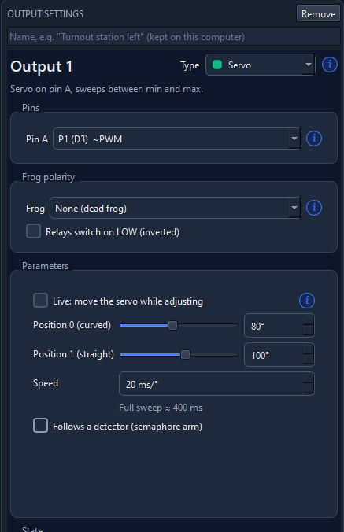

At the bottom you can tick **Follows a detector (semaphore arm)**. The servo then works as part of an automatic block system.
See *Advanced features*.

### Setting servos at the layout

You don't have to run between the PC and the layout.

**With your phone:** see *Phone remote* above. Slide **curved** or **straight** and the servo moves along. The
position is saved at once.

**With the config button and your throttle (no PC needed):**

The config button is a push button from **D2** (the DCC input) to GND.

1. **Hold the config button for 2 seconds.** The LED on the board blinks: config mode.
2. **Short press:** the next servo is selected and moves, so you see which one it is.
3. On your throttle, select **loco address 9999**:
   - the **speed knob** moves the servo;
   - **F1** saves the curved position, **F2** the straight position;
   - **F3** moves the servo over, **F4** inverts its frog relays, **F5** selects the next servo.
4. **Hold the button for 2 seconds** again to stop.

## PWM

The board has 6 PWM pins. PWM makes a lamp or LED strip dim, for example for day and night.

You set the brightness with DCC extended commands or a route. The **fade time** is the time a change from 0 to
255 takes, so the light changes slowly.

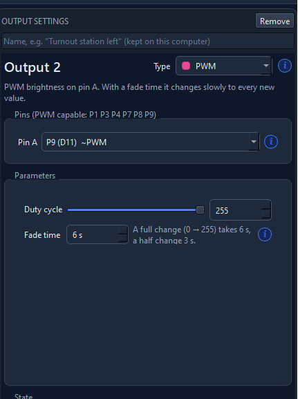

**Note 1:** as soon as you use a servo, D9 and D10 (P7 and P8 on a DCCnext) can no longer do PWM.

**Note 2:** only pins marked with **~ PWM** can be used.

## Sound effect

Plays MP3 files (a bell, an announcement, a whistle) with a **DFPlayer Mini** module.

**Wiring:** DFPlayer RX ← **TX (D1)** of the board through a 1 kΩ resistor, VCC → 5 V, GND → GND, a small
speaker on SPK1 / SPK2.

**SD card:** a folder `MP3` with the files `0001.mp3`, `0002.mp3`, ... The number is the track number. Only MP3.

**In the program:** add one output of type **Sound effect**. It has no settings: whatever starts the sound
chooses the track:

- a **route step** with the track number;
- a **Direct control** input with **Custom values** (for example off = stop, on = track 3). These are ticked by
  themselves when you connect an input to a sound output;
- a **DCC extended** command with the track number.

Track **0 = stop**. Without custom values: on = track 1, off = stop.

**Good to know**

- D1 is also the USB connection. **Sound only plays when no PC is connected.** With the program connected the
  output shows "♪ 3" instead, so you can still see which track would play.
- Sound and the board link both use D1: you can use only one of them.
- In Simulate and Live test the PC plays the track, if you put the same files in `Documents\IOcore\sounds`.

## Block signal

A special 4-aspect signal that sets itself from the track occupancy. See *Advanced features*.

# Inputs

An output does nothing on its own. An input tells it what to do. And we control the inputs: we push buttons,
send DCC commands, our trains drive over sensors.

There are 3 types of inputs: **Direct control**, **Route** and **Sensor (occupancy)**. The last one does not
switch anything by itself.

All inputs have a **Triggered by** section: a DCC address, a pin, or both. So you can run your layout with a
computer program and still have buttons on the panel.

An input pin can also be analog: a voltage between 0 V and 5 V. Think of a light dependent resistor (LDR), or many
buttons on one pin with a resistor ladder. A Nano has 8 of these pins (A0–A7).

An analog pin triggers when the value is **below** a value, **above** a value, or **at** a value (with a small
margin). The last one is for the resistor ladder.

Calculating the right value is not always easy, so the program shows the live value. Press **Use this value** and
the current value becomes the threshold.

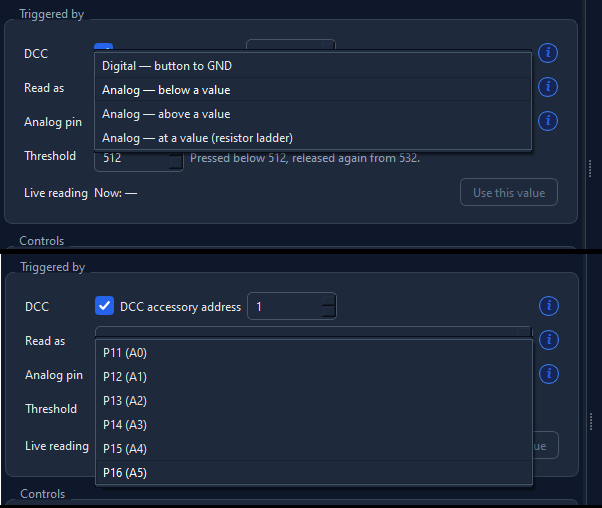

## Direct control

A direct control input controls one output. That's it.

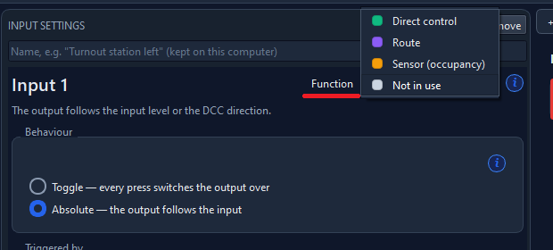

Connect an input to an output by drawing a line between them, or choose the output in the list under
**Controls**.

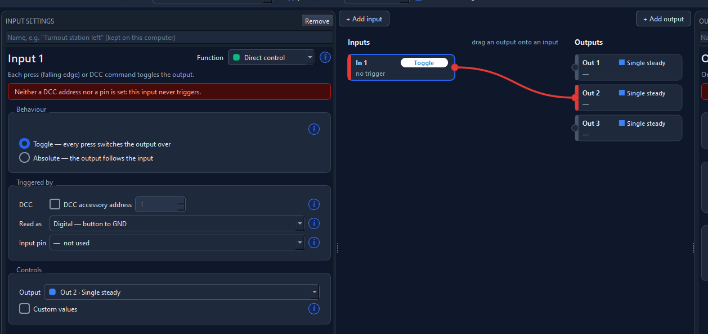

Under **Behaviour** you choose:

- **Absolute**: the output follows the input. Input high → output high. Input low → output low.
- **Toggle**: every press switches the output over. With a DCC address it does not matter whether you send
  straight or curved: every command switches the output over.

With **Custom values** straight and curved get other values. For example two brightness levels of an LED strip,
or two different sounds.

## Routes & Sequences

One of the best features of this board: set a complete route or a sequence, each step with its own value and, if
you want, its own wait time.

This lets you make a small program that does anything. A few examples:

- A level crossing started by a DCC command.
- Routes for turnouts: choose a track with a DCC command or a button, and set up to 16 turnouts.
- An animation for a crane with servos.
- An LED strip with day and night.
- Lights in houses that go on and off one by one.

A route starts in the same way as direct control: a button, a DCC address or an analog sensor.

## Making a route

Set the **Function** of the input to **Route**.

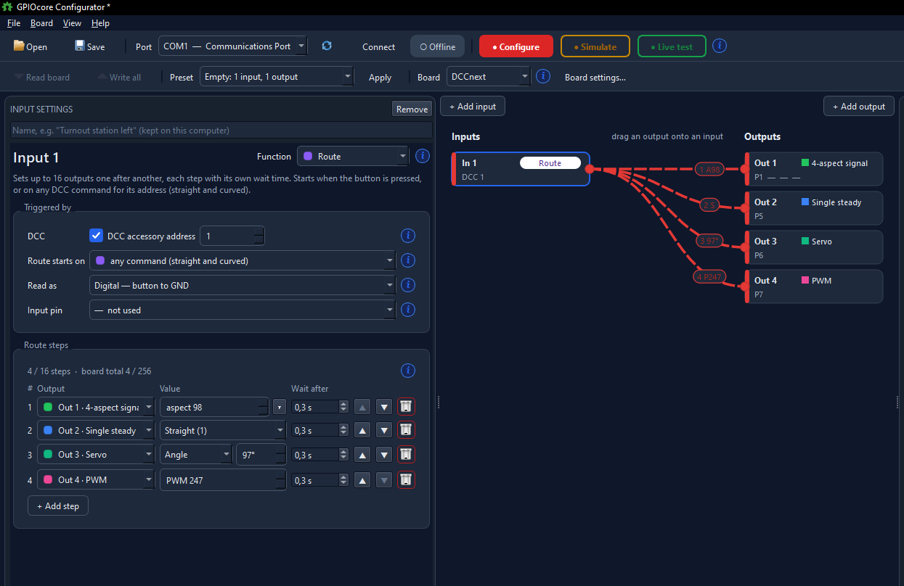

Draw lines from the input to the outputs you want: each line is a step. Then set the value of each step, and if
you want the wait time. The default is 0.3 s.

**Add step** adds more steps, up to 16 per route.

After each step there are 3 buttons: two arrows and a bin. The bin removes the step; the arrows change the order.
For turnouts the order hardly matters, but for a level crossing the order and timing matter a lot.

## Custom values

Servos, PWM and signals can get a custom value in a route. A servo can also simply go to one of its two positions.

For signals you choose the aspect lamp by lamp; the route uses the right number. No calculations needed.

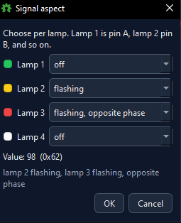

## Board 2 board connections

A route can also set turnouts and signals on other boards that are connected to this one. Not only straight or
curved, but custom values as well: an aspect on a signal of another board, or a 3-position semaphore, no problem.
See *Advanced features*.

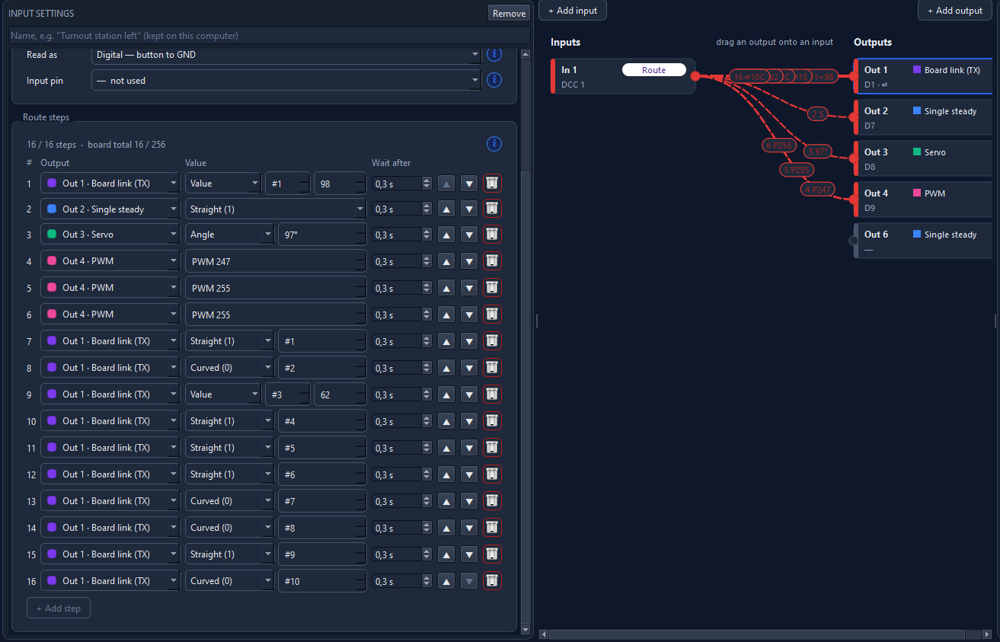

## Interlocking

What if you start a route while another one is still running? You choose that in **Board settings → Route
interlocking**:

- **Off**: both routes run at the same time. Fast on a large yard, but if two routes use the same turnout, you
  get a mess.
- **On**: one route at a time; the second one is ignored.
- **Automatic**: routes with turnouts one at a time, routes with only lights may run together.

## Sensor (occupancy)

The last type of input is the sensor or occupancy detector. It does not control an output itself: block signals
and servos read it, so they know what to do. Apart from the trigger there are no settings. See *Advanced
features*.

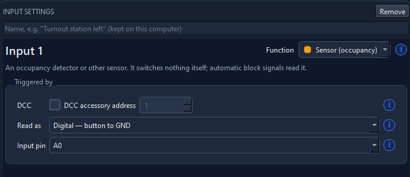

# Advanced Features

## TX link: let boards work together

One board with all the buttons, and the turnouts and signals on other boards? Link the boards with one wire.

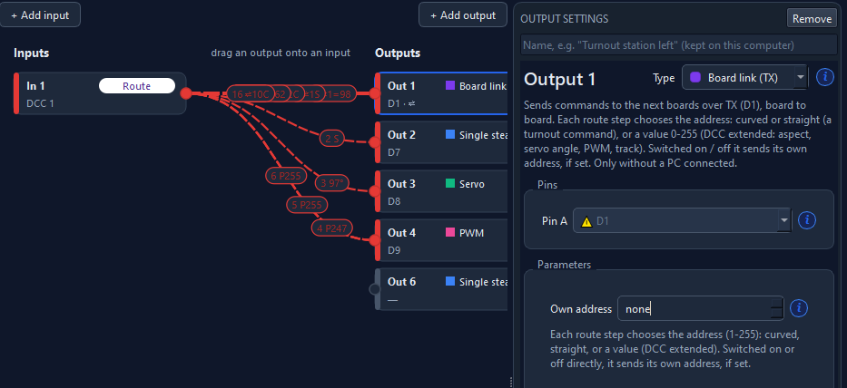

**Wiring**

- **TX (D1)** of the first board goes to **RX (D0)** of the second board. TX of the second board to RX of the
  third, and so on. Connect the GND of all boards.
- Up to 16 boards after the first one.
- Do not connect the last board back to the first.
- Keep the wires short: this is for boards close to each other.

**The first board (the one that sends)**

1. Add an output of type **Board link (TX)**. It is always on D1.
2. Add an input of type **Route**. Each step to the board link gets:
   - an **address** (#1–#255), and
   - **Curved**, **Straight**, or **Value** (0–255: a signal aspect, a servo angle, a PWM value, a sound track).
3. The **wait time** of each step is also the time between the commands. So the turnouts move one by one.

**Own address:** give the board link output an address, and you can also use it without a route. A direct control
input then sends straight or curved to that address. One button, one turnout on another board.

**The other boards (the ones that receive)**

Set them up as a normal DCC decoder. Every board does two things with a command:

1. it passes it on to the next board at once, and
2. it carries it out, exactly as if it came from your DCC command station.

So an input with DCC address 5 on any board reacts to the step "#5 Straight". A **Value** step works like a DCC
extended command: a signal shows that aspect, a servo goes to that angle. The receiving boards need no other
setting.

**Good to know**

- The board link and your DCC command station use the same addresses. Address 5 over the link and address 5 from
  your command station switch the same input. Use addresses your command station does not use, unless you want
  both to work.
- The link only works **without a PC**: 5 seconds after power-up the serial line becomes the board link. With the
  program connected, the line belongs to the program.
- D1 is used by the board link, so it cannot also be used for a sound effect output (the DFPlayer).
- Not on a DCCnext: it has no D0 / D1 on its terminals.

### Not a link, but D0 / D1 as normal pins

Don't need the board link? Tick **D0 / D1 as inputs and outputs (no board link)** in **Board settings**. Without a
PC connected, D0 and D1 are then normal pins. For example: pass an occupancy detector to the next board, with a
Single steady output on D1 and, through an optocoupler, a Sensor input on D0 of the next board. With the PC
connected these two pins belong to the USB connection.

## Block signals

<!-- Draft from the old README: rework with your screenshots -->

A **Block signal** output sets its own aspect from track occupancy, without DCC or a route. You choose:

- **Own block:** the detector input of the block behind the signal;
- **Next block:** the detector input of the block after that, or *none*;
- three **aspects** (any combination of lamps, also flashing): *own block occupied*, *next block occupied* and
  *both free*.

The board looks at the detectors every 50 ms, so the signals are right again straight after power-up. Inputs,
routes and DCC cannot set a block signal.

| Signal | Own block | Next block | Occupied | Next occupied | Free |
|---|---|---|---|---|---|
| Dutch 3-aspect, linked blocks | its block | the next block | red | yellow | green |
| Main signal, blocks not linked | its block | none | red | – | green |
| Distant signal (own output) | the block of the main signal ahead | none | yellow | – | green |

One detector may drive several signals (a main signal and its distant signal).

**Detectors:** use inputs with function **Sensor (occupancy)**: occupied = the pin is pulled to GND (or the
analog condition is true). Any input in use counts as a detector, so an **Absolute** input can be a detector
*and* switch an output, for example a panel LED or the line to the next board.

**Semaphore signals:** a servo can follow a detector (*Follows a detector (semaphore arm)*): occupied = curved
(stop), free = straight (clear), or swapped.

**Linking boards:** the last signal of a board needs the first block of the next board. Pass that detector on
with D0 / D1 (see *TX link*) or through an optocoupler to a free pin, as a Sensor input.

# When something doesn't work

| Problem | Try this |
|---|---|
| The port is not in the list | Use a data USB cable (some cables only charge). Click ⟳. A CH340 clone may need the CH340 driver. |
| "Port busy" / can't connect | Close other programs that use the port (Arduino IDE, serial monitor). |
| Servos twitch or the Nano restarts | Give the servos their own 5 V supply and connect its GND to the GND of the board. |
| A coil turnout doesn't throw | Make the pulse longer (start at 200 ms); check the coil supply and the driver. |
| No sound | Sound only plays without the PC connected. Check the folder and file names (`MP3/0001.mp3`) and the 1 kΩ resistor. |
| A button on a resistor ladder triggers the wrong input | Use the live reading and **Use this value** for every button; keep at least ~40 between the values. |
| The board link does nothing | It only works without a PC connected. Check TX → RX, the common GND, and the DCC addresses on the receiving board. |
| After a firmware update the board is empty | A new firmware can reset the settings. Open your board file and click **Write all**. |
| The program says the firmware is too old | **Board → Flash firmware…** puts the newest version on the board. |
